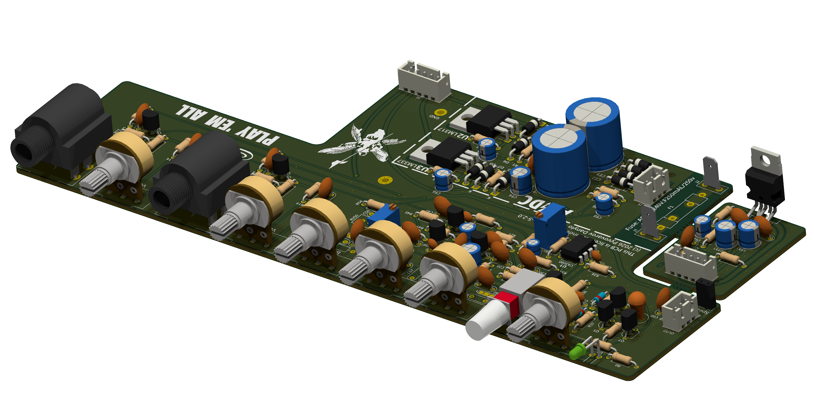

   
   

   
   

# Project Status

   >AMP-MA is currently in the pre-release development phase and is considered unstable. The project is at the stage of creating the first prototype. The first stable release is scheduled for December 2026.

# AMP-MA (AMP Modus Aequale)

AMP-MA (standing for Modus Aequale, signifying a rhythmic, ideal tone and modular structure) is an open-source, transistor-based guitar combo amplifier project. It is designed to bridge the gap between solid-state reliability and the organic, harmonic richness of vacuum tube sound.

The project focuses on a modular architecture, originally developed as a high-fidelity upgrade for the **Epiphone 15C** PCB. By utilizing independent blocks, AMP-MA allows for seamless customization and easier adaptation to various amp enclosures.

   

This project is designed and maintained by: [Danylo Pyvovarov](https://github.com/pivikd).

> Detailed description about project in the Datasheet [-->](#documentation)

   1. [Key Features](#key-features)
   1. [Signal Chain](#signal-chain)
   1. [Integrated Tone Stacks](#integrated-tone-stacks)
   1. [Controls and Connectors](#controls-and-connectors)
   1. [Transistor Notes](#transistor-notes)
   1. [Power Supply](#power-supply)
   1. [Safety](#safety)
   1. [Documentation](#documentation)
   1. [License](#license)
   1. [Credits](#credits)
<!-- 1. [Integrated Effects Modules](#integrated-effects-modules) -->

## Key Features
   - **Tube-like Architecture**: Uses a **Fetzer Valve** based stage with a **2SK30A** JFET to achieve a warm, organic sound and harmonic saturation that mimics vacuum tube behavior.

   - **Dual Input Support**: Designed to handle two guitars simultaneously.

   - **Legendary Tone Stacks**: Features a 3-band EQ based on the classic tone stacks ([Integrated Tone Stacks](#integrated-tone-stacks)).

   - **Integrated Compression**: Built-in compressor block based on the vintage **Ibanez CP835** circuitry.

   - **Modular Tone Stacks**: One board supports three tone stack topologies and five voicings, selected with solder jumpers and component values, so the tone can be changed without redesigning the board.

## Signal Chain
   1. Input buffer
   1. Compressor
   1. Bypass
   1. Preamp
   1. Tone Stack
   1. Amp

<!-- ## Integrated Effects Modules
|       Effect      |   based on   |  Status  |
|-------------------|--------------|---------|
| Compressor        | Ibanez CP835 |  done   |
| Over Drive        | Boss OD3     | planned  |
| Chorus            | Boss Ch1     | planned  | -->

## Integrated Tone Stacks

One board supports three topologies and five voicings. The voicing is selected with solder jumpers and component values.

| Voicing | Values |
|---------|--------|
| Fender Treble-Middle-Bass | original |
| Marshall (JCM900 2100 SL-X) | original |
| Dumble Rock | original |
| **TS-0** (based on Marshall JCM900 2100 SL-X) | own, calculated for real component values |
| **TS-1** (based on Dumble Rock) | own, calculated for real component values |

   - **Fender, Marshall and Dumble Rock** use the original values of the classic circuits.
   - **TS-0 and TS-1** are my own variants: the values are recalculated to sound like the originals while using real, available components.

The exact component values, jumper settings and frequency-response plots are given in the datasheet (see [Documentation](#documentation)), which is still being written.

## Controls and Connectors
   - **Front panel:**
      - 2 inputs (with a volume control for each);
      - tone stack: Bass, Middle, Treble;
      - compressor with Sustain control and a bypass switch with an LED indicator.
   - **Rear panel:**
      - power switch;
      - output for an external speaker.

## Transistor Notes

The circuit uses **2SK30A** JFETs, and their parameters (pinch-off voltage **Vp** and drain current **Idss**) vary widely from device to device. The bias components of the Fetzer Valve stage depend on the specific transistor, so measure Vp and Idss of your own part and calculate the values.

Example for a 2SK30A with the measured values:

| Parameter | Value |
|-----------|-------|
| Vp | 2.2 V |
| Idss | 3.8 mA |
| Vcc | 15 V |
| **Rs** | 481 Ω |
| **Rd** | 2511 Ω |
| **Cp** | 331.2 nF |
| **Av** (gain) | 8.3 dB |

>More details will be given in the datasheet. [-->](#documentation)

## Power Supply
   - Mains transformer module **PXB-10C**, 2 × 14 V AC;
   - fuse **F1** – 250 mA;
   - bridge rectifier (D1–D4);
   - **LM317 / LM337** regulators, approximately ±15 V.

>More details will be given in the datasheet. [-->](#documentation)

## Safety

> [!WARNING]
> The amplifier is powered from the **mains voltage**. Mains voltage is dangerous and can be lethal.
> Build, test and power up the device only if you know how to work with mains-powered equipment.
> Always use the fuse, keep the mains part insulated and enclosed, and disconnect the device from the mains before touching the board.
> The project is an unstable prototype and is provided **without any warranty**. You build and use it at your own risk.

# Other
## Documentation

The datasheet matches the hardware revision in this repository. It is up to date, but **not yet complete**: some sections (for example BOM, PCB layout, build notes, testing, revision history) may still be unfinished, and some specifications may be marked TBD.

   - [Datasheet (PDF)](AMP_MA.pdf)

## License

Schematics, PCB layout, and all source files and documentation are licensed under
[CERN-OHL-S-2.0](LICENSE). Copyright (c) 2026 Pyvovarov Danylo.

   ### Exceptions

   The following artwork elements are **not covered by CERN-OHL-S-2.0** and are not
   licensed under it. They are included solely as cultural references to 1990s and
   2000s rock music design:

   - the snake silhouette from Metallica Black album;
   - the winged figure silhouette from Linkin Park Hybrid Theory album;
<!--   - the "AC/DC" lettering with the lightning bolt. -->

   All rights to these images and names remain with their respective rights holders.
   They are not part of the open-source license and may not be reused without
   permission from the rights holder.
# Credits

   - Compressor: **Ibanez CP835** - [schematic](https://www.scribd.com/document/976348354/Ibanez-CP835-Schematic)
   - Preamp: **Fetzer Valve** - [Runoff Groove](https://www.runoffgroove.com/fetzervalve.html)
   - Tone stack: **Marshall JCM900 2100 SL-X** - [Stompbox Electronics, "The Marshall Tone Stacks"](https://stompboxelectronics.com/2023/12/16/the-marshall-tone-stacks/)
   - Power amplifier: **LM1875** - [Texas Instruments datasheet](https://www.ti.com/lit/ds/symlink/lm1875.pdf)
   - Tone stack: **Fender TMB** and **Dumble Rock** - [Yet Another Tonestack Calculator](https://tonestack.yuriturov.com/)
   - **Epiphone 15C** – the amplifier whose PCB this project was originally designed to upgrade

   All product names and trademarks (Ibanez, Fender, Marshall, Dumble, Epiphone, Metallica, Linkin Park, AC/DC) belong to their respective owners.
   This project is not affiliated with or endorsed by them.

#
>Handcrafted by human. AI was used to help format and write the text of this README and the datasheet.